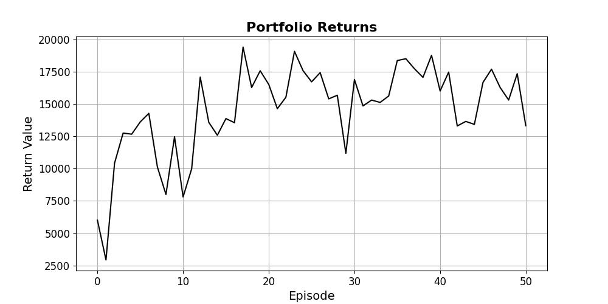
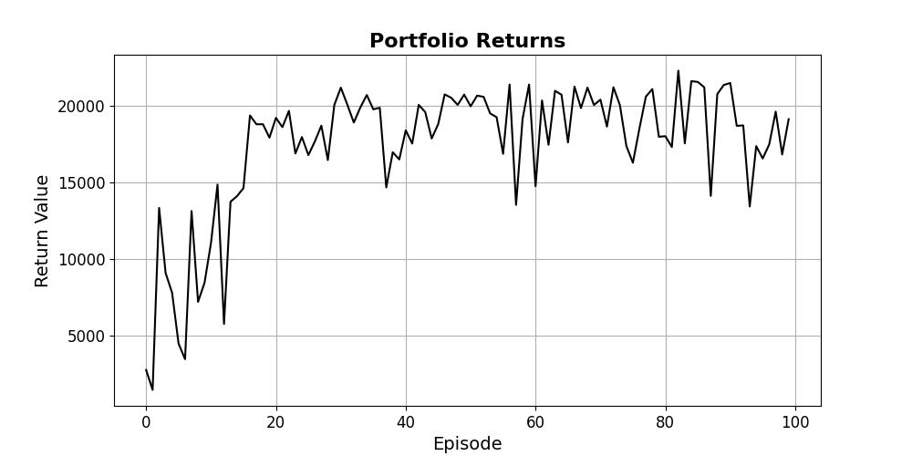
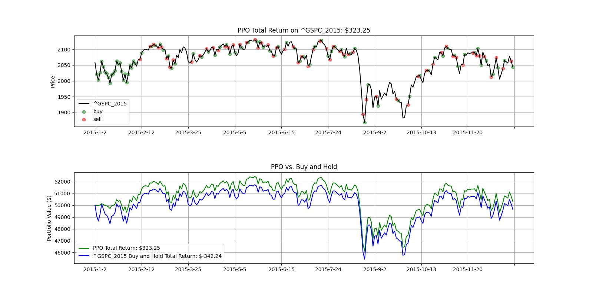
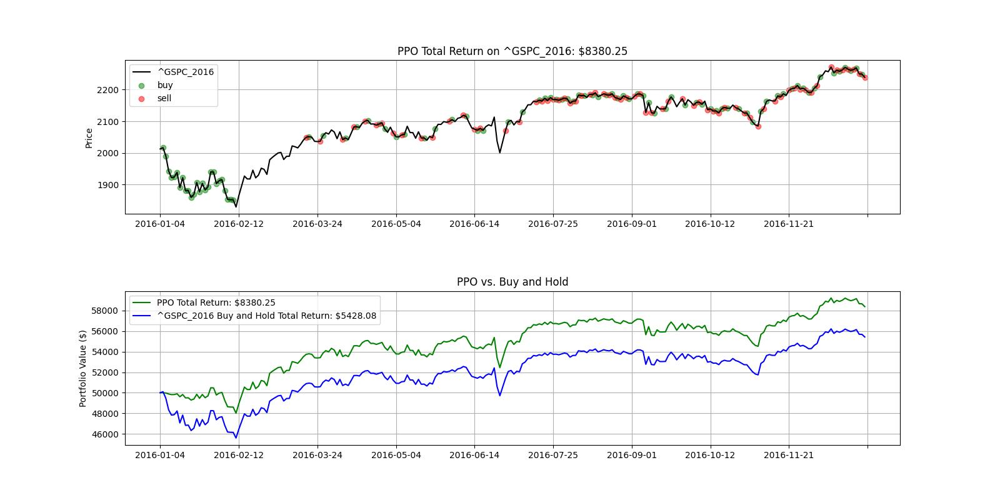

# DRST

```bash
python train.py --model_name=DQN --stock_name=^GSPC_2012-2014 --num_episode=100 --seed=202611
python train.py --model_name=PPO --stock_name=^GSPC_2012-2014 --num_episode=100 --seed=202611
python evaluate.py --model_to_load=PPO_ep100 --stock_name=^GSPC_2015
```

## Visualizations

| DQN | PPO |
| --- | --- |
|  |  |

| PPO on ^GSPC 2015 | PPO on ^GSPC 2016 |
| --- | --- |
|  |  |
