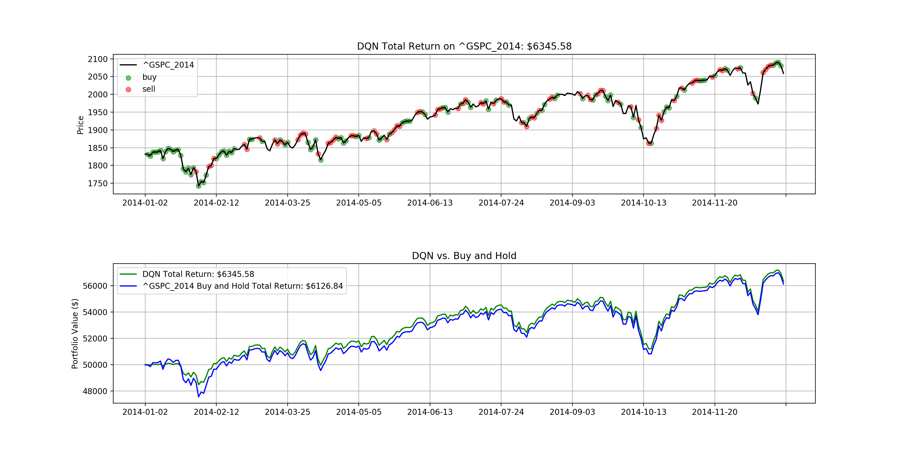
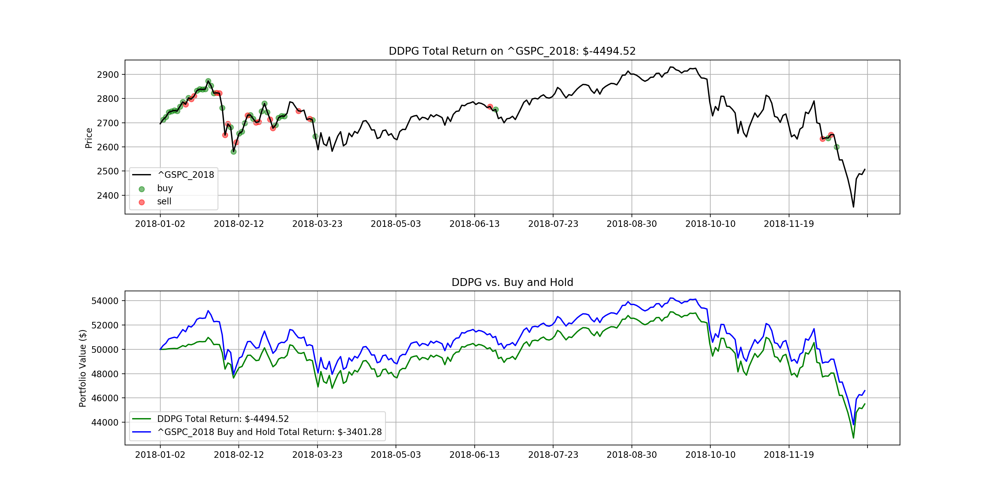

# Deep-Reinforcement-Stock-Trading

This project explores deep reinforcement learning for single-stock trading. The framework structure is inspired by [Q-Trader](https://github.com/edwardhdlu/q-trader). Each transition observes the portfolio and prices through day `t-1`, executes one action at day `t`'s closing price, then builds the next state from the updated portfolio. The reward is the change in portfolio value divided by initial capital.

Key assumptions and limitations of the current framework:
- trading has no impact on the market
- only single stock type is supported
- only 3 basic actions: buy, hold, sell (no short selling or other complex actions)
- the agent performs only 1 action for portfolio reallocation at the end of each trade day
- all reallocations can be finished at the closing prices
- no missing data in price history
- no transaction cost

Key challenges of the current framework:
- implementing algorithms from scratch with a thorough understanding of their pros and cons
- building a reliable reward mechanism (learning tends to be stationary/stuck in local optima quite often)
- ensuring the framework is scalable and extensible

The state contains clipped log returns over the previous `n` days, plus cash and stock exposure ratios. The discrete actions are `Hold`, `Buy` one share, and `Sell` one share. Buy and sell actions are masked when they are not feasible; the mask uses information available at the previous close, and a buy is still checked against its execution price. Episodes follow consecutive trading days. DQN replay randomly selects a start and uses a contiguous batch that does not cross an episode boundary; PPO computes advantages over each chronological episode before updating.

The project includes DQN, Double DQN (DDQN), and Proximal Policy Optimization (PPO). DDPG is not offered by the training entry point because its continuous actor output is incompatible with this environment's discrete actions. PPO uses a categorical policy for the three discrete actions, collects one episode of on-policy transitions, computes generalized advantage estimates, and performs clipped policy updates. It does not use the replay buffer used by DQN-family agents.

### Getting Started
To install all libraries/dependencies used in this project, run
```bash
pip3 install -r requirements.txt
```

To train an agent, e.g. DQN over S&P 500 from 2010 to 2015, run
```bash
python3 train.py --model_name=DQN --stock_name=^GSPC_2010-2015 --num_episode=10 --episode_length=252
```

- `model_name`      is the model to use: `DQN`, `DDQN`, or `PPO`; default is `DQN`
- `stock_name`      is the stock used to train the model; default is `^GSPC_2010-2015`, which is S&P 500 from 1/1/2010 to 12/31/2015
- `train_stocks`    optionally accepts multiple training CSV names; each episode samples one CSV and one random window
- `window_size`     is the span (days) of observation; default is `10`
- `num_episode`     is the number of episodes used for training; default is `10`
- `initial_balance` is the initial balance of the portfolio; default is `50000`
- `episode_length` is the number of trading days per episode; episodes sample random windows from the training CSV; use `0` for the full CSV
- `seed` sets Python, NumPy, and TensorFlow random seeds for reproducible runs; default is `42`. Set a different value to run another randomized trial.

Models are saved every five episodes under `saved_models/`. To evaluate a saved PPO model, run
```bash
python3 evaluate.py --model_to_load=PPO_ep10 --stock_name=^GSPC_2018
```

Training also writes one CSV row per episode to `logs/<MODEL>_episode_metrics_<STOCK>_seed<SEED>.csv`. It includes the sampled date window, portfolio performance, action counts, and mean training loss for that episode; DQN-family agents also include epsilon. Maximum drawdown is stored as a negative fraction (for example, `-0.05` means `-5%`), and returns are stored as decimal fractions unless the column is named `total_return`, which is in the account currency.

- `model_to_load`   is the checkpoint name without its file extension; for example, `PPO_ep10`, `DQN_ep10`, or `DDPG_ep10`
- `stock_name`   is the stock used to evaluate the model; default is `^GSPC_2018`, which is S&P 500 from 1/1/2018 to 12/31/2018
- `initial_balance` is the initial balance of the portfolio; default is `50000`
- `window_size`     is the span (days) of observation; default is `10`

where `stock_name` refers to a CSV file in `data/` and `model_to_load` refers to a checkpoint in `saved_models/`. Evaluate on a different time period from the training CSV (for example, train on `^GSPC_2010-2015` and evaluate on `^GSPC_2018`) to keep the evaluation period independent.
The state shape and reward changed, so checkpoints created before this update must be retrained before evaluation.

To visualize training loss and portfolio value fluctuations history, run:
```bash
tensorboard --logdir=logs/model_events
```
where `model_events` can be found in `logs` directory.

### Example Results
Note that the following results were obtained with 10 epochs of training only. 




### Frequently Asked Questions (FAQ)
- How is this project different from other price prediction approaches, such as logistic regression or LSTM?
  - Price prediction approaches like logistic regression have numerical outputs, which have to be mapped (through some interpretation of the predicted price) to action space (e.g. buy, sell, hold) separately. On the other hand, reinforcement learning approaches directly output the agent's action.


### References:
- [Deep Q-Learning with Keras and Gym](https://keon.io/deep-q-learning/)
- [Double Deep Q Networks](https://towardsdatascience.com/double-deep-q-networks-905dd8325412)
- [Proximal Policy Optimization Algorithms](https://arxiv.org/abs/1707.06347)
- [Using Keras and Deep Deterministic Policy Gradient to play TORCS](https://yanpanlau.github.io/2016/10/11/Torcs-Keras.html)
- [Practical Deep Reinforcement Learning Approach for Stock Trading](https://arxiv.org/abs/1811.07522)
- [Introduction to Learning to Trade with Reinforcement Learning](http://www.wildml.com/)
- [Adversarial Deep Reinforcement Learning in Portfolio Management](https://arxiv.org/abs/1808.09940)
- [A Deep Reinforcement Learning Framework for the Financial Portfolio Management Problem](https://arxiv.org/abs/1706.10059)
